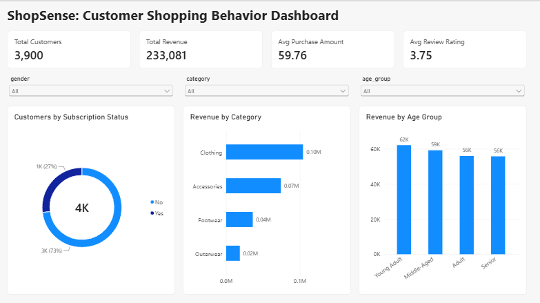

# ShopSense: Customer Shopping Behavior Analytics

An end-to-end data analytics project that takes a raw retail dataset through cleaning (Python), analysis (PostgreSQL and SQL), and visualization (Power BI) to answer one business question: **who are our customers, what do they buy, and how can we grow sales and loyalty?**



## Business problem

A retail company wants to understand how its customers shop so it can increase sales, improve satisfaction, and build long-term loyalty. This project analyzes purchase data across demographics, product categories, discounts, subscriptions, and customer segments, and turns the findings into recommendations.

**Key questions**

1. Which age groups and genders generate the most revenue?
2. Which product categories and items sell best?
3. Do discounts and promo codes influence spending?
4. How do new, returning, and loyal customers differ?
5. Does subscription status affect purchase behavior?

## Dataset

- **Source:** Customer Shopping Trends dataset from Kaggle (check the license on the dataset's Kaggle page)
- **Size:** 3,900 purchase records, 19 original columns
- **Contents:** customer age and gender, item and category, purchase amount, location, season, review rating, subscription status, discount and promo code use, previous purchases, purchase frequency
- **Quality:** no missing values and no duplicate rows

## Tools

| Stage | Tools |
|---|---|
| Cleaning and feature engineering | Python, pandas, Jupyter (VS Code) |
| Storage and analysis | PostgreSQL, SQLAlchemy, SQL (pgAdmin) |
| Visualization | Power BI, DAX |
| Version control | Git, GitHub |

## Project structure

```
ShopSense-Customer-Analytics/
├── data/           raw and cleaned CSV files
├── notebooks/      01_data_cleaning.ipynb, 02_load_to_database.ipynb
├── sql/            shopsense_analysis.sql (all business queries)
├── dashboard/      Power BI file and dashboard screenshots
├── reports/        problem statement, insights, and project report
├── requirements.txt
└── README.md
```

## Workflow

1. **Problem definition:** wrote the business problem and five key questions.
2. **Cleaning (Python):** checked duplicates and missing values, standardized column names to snake_case, created `age_group` (four quartile-based groups) and `purchase_frequency_days` (numeric version of purchase frequency), and dropped `promo_code_used` because it was identical to `discount_applied`.
3. **Database (PostgreSQL):** loaded the cleaned data (3,900 rows, 20 columns) into a `customer` table using SQLAlchemy.
4. **Analysis (SQL):** ten queries using GROUP BY, subqueries, CASE statements, CTEs, and window functions (`ROW_NUMBER() OVER (PARTITION BY ...)`).
5. **Dashboard (Power BI):** connected to PostgreSQL, built DAX measures (Total Customers, Total Revenue, Average Purchase Amount, Average Review Rating), and built an interactive dashboard with slicers for gender, category, and age group. Dashboard totals were checked against the SQL results.
6. **Reporting:** wrote a project report with insights, recommendations, and limitations.

## Key findings

- **Gender:** male customers generate about 68% of revenue (157,890 of 233,081), but only because they are 68% of customers. Average spend per customer is nearly equal (female 60.25, male 59.54), so the opportunity is acquiring more female customers.
- **Age:** spending is spread fairly evenly. The top group (Young Adult, 62,143) is only about 11% above the lowest (Senior, 55,763).
- **Categories:** Clothing drives about 45% of orders. Footwear has the highest average spend (60.26) and rating (3.79).
- **Subscriptions:** subscribers (27% of customers) spend about the same per order as non-subscribers (59.49 vs 59.87). All 1,053 subscribers are male, and no female customer subscribes.
- **Discounts:** 839 customers used a discount and still spent at or above the average purchase. Hat, Sneakers, and Coat have the highest discount dependence (about 49 to 50% of purchases).
- **Customer segments:** about 80% of customers are Loyal (more than 10 previous purchases), 18% Returning, and only 2% New.

## Recommendations

- Run acquisition campaigns aimed at female customers.
- Redesign or investigate the subscription program, which reaches only male customers and does not raise spend per order.
- Review discount depth on heavily discounted products.
- Strengthen first-purchase offers, because new customers are only 2% of the base.
- Promote Footwear and look for upselling opportunities in Outerwear.

## Limitations

- The dataset has no purchase dates, so trends over time cannot be analyzed.
- There is no cost or margin data, so profitability is unknown.
- Segment thresholds (New, Returning, Loyal) are a business judgment.
- The all-male subscriber pattern should be verified against how the data was collected.
- Findings describe patterns in this dataset and do not prove cause and effect.

## How to run it

1. Clone the repository and open the folder in VS Code.
2. Create and activate a virtual environment, then install the libraries:
   ```
   python -m venv venv
   venv\Scripts\activate
   pip install -r requirements.txt
   ```
3. Install PostgreSQL and create a database named `shopsense_db`.
4. Run `notebooks/01_data_cleaning.ipynb`, then `notebooks/02_load_to_database.ipynb` (it asks for your PostgreSQL password when you run it).
5. Run the queries in `sql/shopsense_analysis.sql` in pgAdmin.
6. Open the Power BI file in `dashboard/` and update the data source to point to your local `shopsense_db`.

## Author

**Aditya Kumar**
GitHub: [Aditya75420](https://github.com/Aditya75420)
LinkedIn: add your profile link here